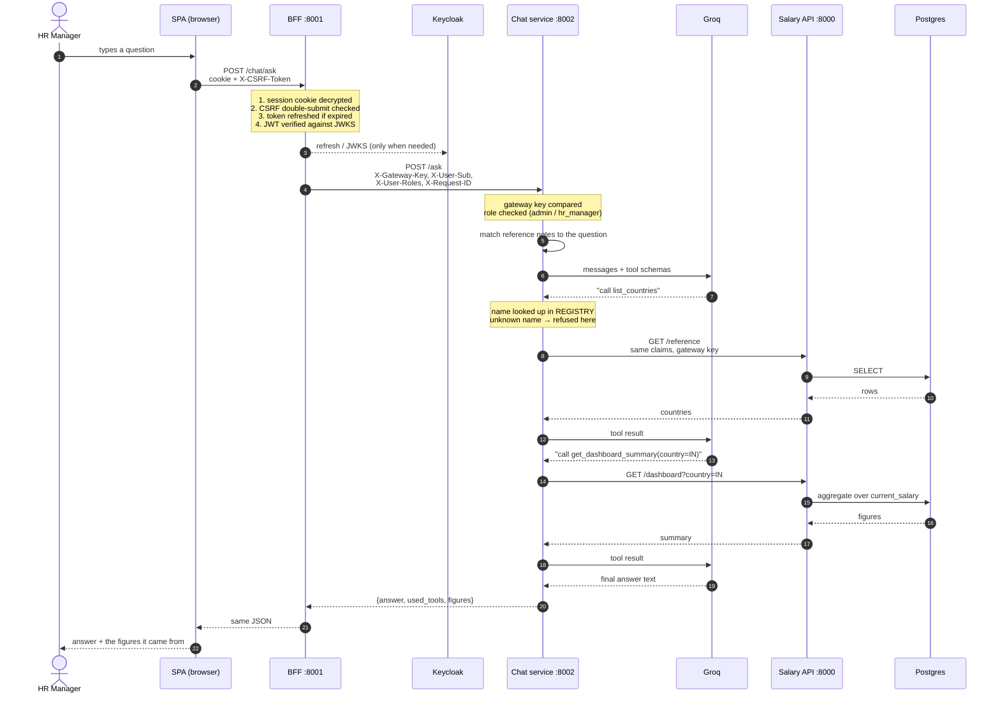

# How a chat request travels

One question — *"What is our average salary in India?"* — from keystroke to answer.

Four processes are involved and each one refuses the request if it is wrong, so no
single failure opens the others.

## The path

## What each hop decides

| Hop | Decides | Refuses with |
|---|---|---|
| SPA → BFF | Nothing. It holds no token, only a cookie it cannot read | — |
| **BFF** | Is this a live session? Same-origin? Is the token valid *now*? | 401, 403 (CSRF) |
| BFF → Chat | — | — |
| **Chat** | Did this come from the BFF? May this role use the assistant? | 401, 403 |
| **Chat loop** | Is the requested tool on the menu? Has it run out of turns? | tool refused, loop capped at 3 |
| **Salary API** | Did this come from inside? May *this user* read this? | 401, 403 |
| **Postgres** | Are the constraints satisfied? | — (reads only) |

## The parts worth knowing

**The browser never holds a token.** It sends an encrypted httpOnly cookie. The BFF
is the only thing that sees an access token, and it verifies the signature, issuer
and audience on *every* request — not just at login, so a role revoked in Keycloak
mid-session is caught on the next question.

**Roles come from the token, not the cookie.** The BFF forwards
`X-User-Roles` from the freshly verified claims, so what the chat service and the
salary API authorize on is what Keycloak says now.

**The chat service trusts headers, and that is only safe because of two things.**
It publishes no host port — reachable only on the compose network — and every request
carries `X-Gateway-Key`, compared in constant time before routing. Remove either and
`X-User-Roles` becomes a header anyone can type.

**Tools run as the person asking.** Steps 11 and 16 carry the same claims the BFF
issued. The salary API applies the same role check it applies to the UI, so the
assistant can read exactly what that person could read by clicking — no more.

**The model chooses *which* tool, never *what a tool is*.** It returns a name; the
chat service looks it up in `REGISTRY`. An unknown name is refused before anything
runs, and the model is told so, so it can still answer from what it has.

**The loop is capped at 3 rounds.** Enough for the deepest real chain — resolve a
country name to a code, query it, answer — and small enough that a model stuck in a
loop costs three calls rather than a timeout.

## When something fails

| Failure | What the user sees |
|---|---|
| Session expired | 401 with `login_url`; the SPA sends them to sign in, returning to the page |
| CSRF header missing | 403 from the BFF. The request never reaches the chat service |
| Wrong gateway key | 401 from the chat service. Logged as absent vs mismatch; the response says neither |
| Role not permitted | 403 before the model is called |
| `GROQ_API_KEY` unset | 503, "the assistant is not configured" — stated at startup too |
| Groq rate-limited (free tier) | 503, "unavailable right now, please try again" |
| Salary API down | The *answer still arrives*: the tool result becomes "could not be reached", and the model says so. One figure lost, not the conversation |
| Model asks for an unknown tool | Refused, conversation continues |

The asymmetry in the last three is deliberate. A model or a session failing is worth
stopping for; one tool failing is not, because an answer that names what it could not
read is more useful than an error page.
