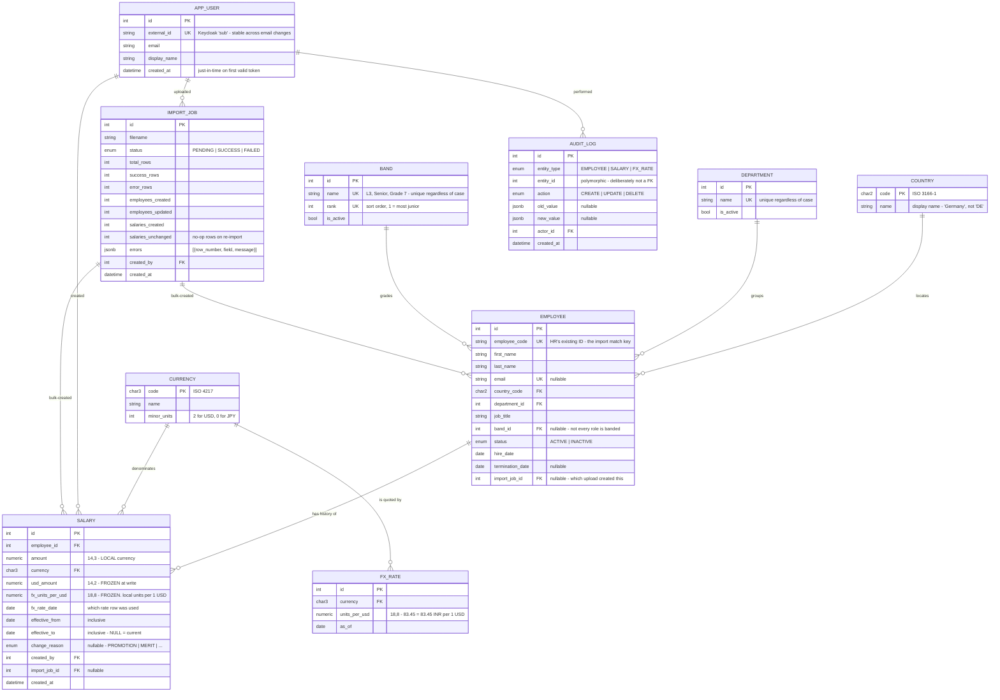
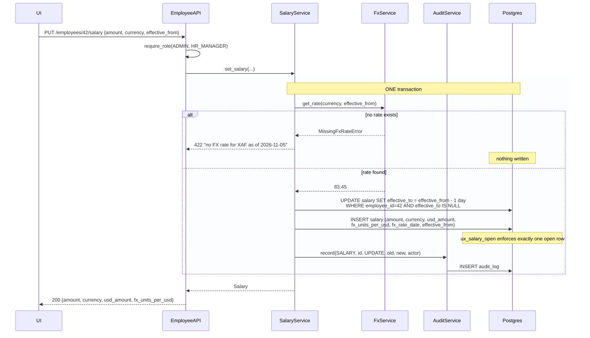
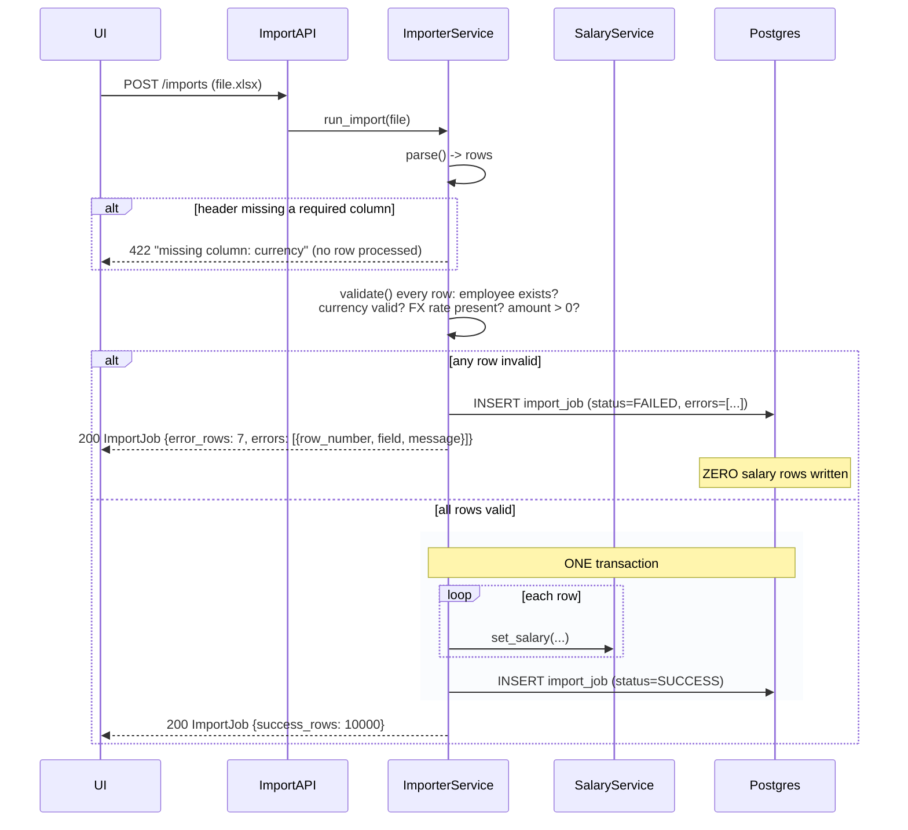

# Design Notes — How We Start Development

Companion to [`requirements.md`](requirements.md) (*what* we build) and
[`plans/2026-11-05-salary-management.md`](plans/2026-11-05-salary-management.md)
(*the task list*). This note is the **how**: the model we design before writing code, and
the order we build in.

---

## 1. Why the model comes first

The build order is **model → services → API → UI → AI**, and that order is not a
preference.

| Layer | Cost to change on day 5 |
|---|---|
| Database schema | Migration + data backfill + every query + every API response + every UI type. Hours to days. |
| Service logic | Change the function, fix its tests. Minutes. |
| API shape | Change the serializer, fix the client type. Minutes. |
| UI | Change the component. Minutes. |

So the schema gets the most thinking and gets it earliest, when it is still free. The ER
diagram is a *planning artifact*, not documentation written afterwards — it is where the
two decisions that define this product get made:

1. Is salary a **column on the employee** or a **row in a history table**?
2. Is the USD figure **stored** or **computed at read time**?

Both are schema questions. Both are unfixable later without a backfill. Both are answered
below before Task 1 of the plan begins.

---

## 2. Domain model in words

Before the diagram, the concepts — the vocabulary the code, the API and the HR Manager all
have to share.

- **Employee** — a person on the org chart. Identified by `employee_code`, the ID HR
  already uses in their spreadsheets. Belongs to one country, one department, and
  optionally one band.
- **Band** — a pay grade: `L3`, `Senior`, `Grade 7`. The normalized axis that makes
  "are we paying Band 5 consistently in India and Germany" answerable — job title cannot
  do that, because the same title means different things in different offices.
- **Salary** — *not a property of an employee*. A **fact that was true over a date range**.
  An employee has a chain of salary rows; exactly one is open (`effective_to IS NULL`) and
  that one is their current pay. A raise does not edit a number — it closes one row and
  opens the next.
- **FxRate** — the rate from a currency to USD, as of a date. Admin-maintained.
- **User** — who logs in. Distinct from Employee: the MVP has no self-service, so the
  10,000 employees are *data*, not *accounts*. One or two Users exist.

  **Identity lives in Keycloak, not here.** This application never sees a password, never
  stores one, and never issues a token. The row exists only so `audit_log.actor_id` has a
  stable local target — "who changed this salary" must still answer in three years, without
  depending on an external service being reachable. It is created just-in-time the first
  time a valid token arrives for an unseen `sub`.

  Roles are **not** stored. They are read from the token's `realm_access.roles` claim on
  every request, because a local copy of an authorization fact drifts the moment someone
  changes a role in Keycloak and nothing tells the database.
- **AuditLog** — who changed what, when, from what, to what. Append-only.
- **ImportJob** — one upload attempt, its outcome, and its per-row errors.

**The distinction that matters most:** *salary history* and *audit log* look similar and
are not the same thing.

- History answers **"what were they paid in June?"** — a business fact, shown to the user,
  used in every report.
- Audit answers **"who changed this, and when?"** — a compliance fact, shown in an audit
  view, never used in a report.

Collapsing them into one table is the classic mistake here; you end up either polluting
payroll totals with correction records, or losing the ability to prove who made a change.

---

## 3. ER diagram

> **This is the revised model.** It was reviewed against the requirements before the
> first migration — see [`model-review.md`](model-review.md), which found 11 issues, three
> of them high severity: `department` as free text would have split one department's
> payroll across several dashboard rows; nothing closed a leaver's open salary row, so
> total payroll was permanently overstated; and nothing in the requirement created an
> employee at all. The `country`, `department` and `currency` reference tables and the
> import upsert below are the outcome of that review.

### How to read the ER diagram

Crow's foot notation. Each side of the line carries **two characters**: the **inner** one
is the minimum, the **outer** one is the maximum. Read each side independently.

| Symbol | Minimum | Maximum | Reads as |
|---|---|---|---|
| `\|\|` | one | one | exactly one |
| `o\|` | zero | one | zero or one (optional) |
| `}\|` | one | many | one or more |
| `}o` | zero | many | zero or more |

Worked example — `EMPLOYEE ||--o{ SALARY` splits into two halves:

| Half | Symbol | Reads |
|---|---|---|
| left (Employee side) | `\|\|` | a salary row belongs to **exactly one** employee |
| right (Salary side) | `o{` | an employee has **zero or more** salary rows |

Together: **one-to-many**. Zero, not one-or-more, because a newly imported employee can
exist before anyone has set their pay.

Two further reading rules:

- **The crow's foot points at the foreign key.** The `{` end is always the table that
  holds the FK column — `salary` holds `employee_id`, `employee` holds `country_code`.
- **Every relationship in this model is one-to-many.** There is no one-to-one and no
  many-to-many, deliberately: a one-to-one usually means two tables that should be one,
  and a many-to-many needs a join table that has to earn its place.

Inside each entity block, the annotations mean:

| Marker | Meaning |
|---|---|
| `PK` | primary key |
| `FK` | foreign key |
| `UK` | unique key — not the primary key, but no two rows may share it |
| `"…"` | a comment on that column |



### The relationships, read out

| Relationship | Cardinality | Why it exists |
|---|---|---|
| Employee → Salary | 1 : 0..N | Salary is a **history**, not a field. Exactly one row is open at a time. Zero, because an imported employee can exist before their pay is agreed. |
| Country → Employee | 1 : 0..N | Validates import and gives the dashboard a display name |
| Department → Employee | 1 : 0..N | Keeps dashboard grouping from splitting on Excel typos |
| Band → Employee | 1 : 0..N | Pay grade. Nullable, because contractors and executives often sit outside the banding system. Carries an explicit `rank`, since `L1, L10, L11, L2` is how text sorts and a band chart in that order is unreadable |
| Currency → Salary | 1 : 0..N | The local currency the amount is stored in |
| Currency → FxRate | 1 : 0..N | One rate series per currency, one rate per day |
| User → Salary (`created_by`) | 1 : 0..N | Who entered the figure — a business fact |
| User → AuditLog (`actor_id`) | 1 : 0..N | Who made the change — a compliance fact |
| User → ImportJob | 1 : 0..N | Who uploaded the file |
| ImportJob → Employee | 1 : 0..N | Import **creates** employees, not just salaries — the only viable migration path |
| ImportJob → Salary | 1 : 0..N | "Which rows did that file create" |
| **FxRate → Salary** | **none** | **Deliberately no foreign key.** The rate is *copied* onto the salary row, not referenced. A reference would let an edited rate change a historical figure — the thing this whole design exists to prevent. |

Every relationship is one-to-many. There is no one-to-one and no many-to-many: a
one-to-one usually means two tables that should be one, and a many-to-many needs a join
table that has to earn its place.

### Constraints the diagram cannot show

These are the schema, not implementation detail. They go in the first migration.

```sql
-- "Exactly one current salary per employee" as a database guarantee,
-- not an application convention. This is the single most important line
-- in the schema.
CREATE UNIQUE INDEX ux_salary_open ON salary (employee_id)
    WHERE effective_to IS NULL;

-- A salary range must be sane.
ALTER TABLE salary ADD CONSTRAINT ck_salary_range
    CHECK (effective_to IS NULL OR effective_to > effective_from);

ALTER TABLE salary ADD CONSTRAINT ck_salary_positive
    CHECK (amount > 0 AND usd_amount > 0);

-- One rate per currency per day.
CREATE UNIQUE INDEX ux_fx_currency_date ON fx_rate (currency, as_of);

-- Department names are unique regardless of case, so an import cannot
-- create 'Engineering' alongside an existing 'engineering'.
CREATE UNIQUE INDEX ux_department_name ON department (lower(name));

-- Same for band names, and one band per rank so the sort order is total.
CREATE UNIQUE INDEX ux_band_name ON band (lower(name));
CREATE UNIQUE INDEX ux_band_rank ON band (rank);

-- A leaver must carry the date they left; set_status closes their open
-- salary row with that date in the same transaction.
ALTER TABLE employee ADD CONSTRAINT ck_inactive_has_termination_date
    CHECK (status = 'ACTIVE' OR termination_date IS NOT NULL);

-- The one definition of "who is on the payroll right now". Every
-- aggregate, list and export reads this; nothing reads salary directly
-- except history queries, which must include leavers.
CREATE VIEW current_salary AS
SELECT s.*, e.country_code, e.department_id, e.band_id
FROM salary s
JOIN employee e ON e.id = s.employee_id
WHERE s.effective_to IS NULL AND e.status = 'ACTIVE';

-- Reference integrity replaces free text:
--   employee.country_code  -> country.code
--   employee.department_id -> department.id
--   salary.currency        -> currency.code
--   fx_rate.currency       -> currency.code

-- Read-path indexes, justified in docs/performance.md with EXPLAIN ANALYZE.
CREATE INDEX ix_salary_history   ON salary (employee_id, effective_from DESC);
CREATE INDEX ix_employee_country ON employee (country_code);
CREATE INDEX ix_employee_dept    ON employee (department_id);
CREATE INDEX ix_employee_band    ON employee (band_id);
CREATE INDEX ix_employee_name    ON employee (lower(last_name));

-- Every payroll aggregate filters on ACTIVE; make that filter cheap.
CREATE INDEX ix_employee_active  ON employee (status) WHERE status = 'ACTIVE';
```

**Why `ux_salary_open` matters:** every dashboard number, every list row and every export
is `JOIN salary ON effective_to IS NULL`. If a bug ever leaves two open rows, total payroll
is silently wrong and nothing errors. The index makes that bug impossible to persist — the
second insert raises `IntegrityError` instead of corrupting every report.

**Why the `current_salary` view exists:** every aggregate needs "who is on the payroll
right now", and writing that predicate at each call site is how one query eventually
forgets it and counts leavers in total payroll — permanently, with nothing raising. The
view states it once. Its status filter is belt-and-braces on top of the closed row.

**Why `app_user` and not `user`:** `user` is a reserved word in Postgres. The table can
exist as `"user"`, but every query then has to quote it forever, and the one that forgets
fails at runtime rather than at review. A two-character prefix costs nothing.

**Why `amount` is `NUMERIC(14,3)` while `usd_amount` is `NUMERIC(14,2)`:** KWD, BHD, OMR
and JOD have three minor units. Stored at two places, a Kuwaiti salary silently loses its
last digit — the kind of defect that surfaces six months later, from Finance, about a
number already reported. USD has two places, so the reporting column needs no widening.
`currency.minor_units` says how many places to display. Widening now is one character;
widening after 25,000 rows exist is a migration and a backfill.

**Why `usd_amount` and `fx_units_per_usd` are columns and not a computed view:** if USD were
computed at read time, an admin correcting October's INR rate would silently change
October's payroll total, which an HR Manager already exported and sent to Finance. Freezing
the rate on the row means a correction affects only salaries written after it.

### Data volumes we are designing for

| Table | Rows at launch | Growth |
|---|---|---|
| `employee` | 10,000 | ~2,000/yr |
| `salary` | ~25,000 (1–4 per employee) | ~10,000/yr |
| `fx_rate` | ~12 currencies × dates | small |
| `audit_log` | grows with edits | append-only |
| `country` / `department` / `currency` / `band` | tens of rows | effectively static |

25,000 salary rows is a **small** table. Postgres answers every query in this product from
indexes in single-digit milliseconds. This is why the plan has no Redis, no read replica
and no materialized views — see [`tradeoffs.md`](tradeoffs.md). The scale number (10,000)
sets the *UI* requirement (server-side pagination, no "load all") far more than the
*database* requirement.

---

## 4. Class / component diagram

Three layers, one rule: **`api` never touches the database, `services` is the only layer
that writes.**

```mermaid
classDiagram
    direction TB

    class EmployeeAPI {
        <<api>>
        +list(q, country, department, sort, page, size) Page~EmployeeOut~
        +detail(id) EmployeeDetailOut
        +update_salary(id, SalaryIn) SalaryOut
        +export(filters) StreamingResponse
    }
    class DashboardAPI {
        <<api>>
        +summary(country, department) DashboardOut
    }
    class ImportAPI {
        <<api>>
        +upload(file) ImportJobOut
        +status(job_id) ImportJobOut
    }
    class ChatAPI {
        <<api>>
        +ask(question) ChatAnswerOut
    }
    class FxAPI {
        <<api>>
        +list(currency, page, size) Page~FxRateOut~
        +create(FxRateIn) FxRateOut
    }
    class ReferenceAPI {
        <<api>>
        +all() ReferenceOut
    }

    class EmployeeService {
        <<service>>
        +create(data, actor_id) Employee
        +update(id, data, actor_id) Employee
        +set_status(id, status, termination_date, actor_id) Employee
        +search(filters, sort, page, size) Page~EmployeeOut~
    }
    class SalaryService {
        <<service>>
        +set_salary(employee_id, amount, currency, effective_from, actor_id) SalaryChange
        +get_current_salary(employee_id) Salary
        +get_salary_history(employee_id) list~Salary~
        +close_for_termination(employee_id, termination_date, actor_id) Salary
        -close_open_row(employee_id, until) void
    }
    class FxService {
        <<service>>
        +get_rate(currency, as_of) Decimal
        +to_usd(amount, rate) Decimal
    }
    class AuditService {
        <<service>>
        +record(entity_type, entity_id, action, old, new, actor_id) AuditLog
    }
    class ImporterService {
        <<service>>
        +parse(file, filename) list~RawRow~
        +validate(rows) tuple~ValidRows, RowErrors~
        +run_import(file, filename, actor_id) ImportJob
    }
    class AnalyticsService {
        <<service>>
        +summary(country, department) DashboardSummary
    }
    class ChatService {
        <<service>>
        +TOOLS list~ToolSchema~
        +answer(question, user) ChatAnswer
    }

    class Gateway {
        <<cross-cutting>>
        +install_gateway_guard(app, key_provider) void
        -compare_digest(presented, expected) bool
    }
    class Access {
        <<cross-cutting>>
        +current_principal(request) Principal
        +require_role(roles) Depends
    }
    class UserService {
        <<service>>
        +resolve_actor(principal) AppUser
    }

    class Employee
    class Salary
    class FxRate
    class AppUser
    class AuditLog
    class ImportJob

    Gateway ..> Access : every request, before routing
    EmployeeAPI ..> Access : require_role
    DashboardAPI ..> Access : require_role
    ImportAPI ..> Access : require_role
    ChatAPI ..> Access : require_role
    FxAPI ..> Access : require_role(ADMIN) to write
    ReferenceAPI ..> Access : require_role

    EmployeeAPI ..> EmployeeService : create / update / set_status / search
    EmployeeAPI ..> SalaryService : set_salary / history
    FxAPI ..> FxService : list / create
    DashboardAPI ..> AnalyticsService : summary
    ImportAPI ..> ImporterService : run_import / status
    ChatAPI ..> ChatService : answer

    EmployeeService ..> SalaryService : close_for_termination
    EmployeeService ..> AuditService : record per changed field
    SalaryService ..> FxService : get_rate + to_usd
    SalaryService ..> AuditService : record
    ImporterService ..> EmployeeService : upsert per row
    ImporterService ..> SalaryService : set_salary per row
    ChatService ..> AnalyticsService : summary via whitelisted tools

    EmployeeService ..> Employee : INSERT / UPDATE
    SalaryService ..> Salary : INSERT new + close prior row
    FxService ..> FxRate : INSERT admin-entered rate
    AuditService ..> AuditLog : INSERT only - append-only
    ImporterService ..> ImportJob : INSERT then UPDATE counts

    EmployeeService ..> Salary : SELECT current pay via join
    SalaryService ..> Employee : SELECT exists + is ACTIVE
    AnalyticsService ..> Employee : SELECT join for group-by
    AnalyticsService ..> Salary : SELECT aggregate in SQL
    ImporterService ..> Employee : SELECT by employee_code
    UserService ..> AppUser : SELECT by external_id, INSERT on first sight
    EmployeeAPI ..> UserService : resolve the audit actor
    FxAPI ..> UserService : resolve the audit actor
    ReferenceAPI ..> Employee : SELECT distinct for filters

    Salary --> Employee
```



**How to read the class diagram.** Two arrow types, and the difference matters:

| Arrow | Name | Means | Example here |
|---|---|---|---|
| `..>` *(dashed)* | dependency | "calls" or "uses" — A invokes B but does not hold a reference to it | `SalaryService ..> FxService` — salary logic calls the FX service |
| `-->` *(solid)* | association | "holds a reference to" — a structural link stored on the object | `Salary --> Employee` — a salary row carries its employee |

**Every arrow is labelled with the operation it performs**, so the diagram says what
happens rather than only who knows whom. Arrows into a model class carry the SQL verb:
`INSERT`/`UPDATE` marks the one service that owns writes to that table, `SELECT` marks a
read, and reads are allowed to cross service boundaries (see the rule below). The three
most load-bearing labels are `SalaryService ..> Salary : INSERT new + close prior row`,
`AuditService ..> AuditLog : INSERT only - append-only`, and
`EmployeeService ..> SalaryService : close_for_termination`.

Dashed arrows are the layering rule made visible: they all point **downward**
(api → service → model) and never back up. A service never calls an API handler, and a
model never calls a service. If an arrow ever pointed upward, that would be the design
breaking.

`<<api>>`, `<<service>>` and `<<cross-cutting>>` are **stereotypes** — labels marking which
layer a class belongs to.

**What this buys us.** Every business rule — effective-dating, FX freezing, audit writing —
lives in `SalaryService.set_salary`. The manual edit endpoint, the bulk importer and (later)
any integration all go through that one function, so none of them can forget to write an
audit row or freeze a rate. Adding a new way to change a salary cannot introduce a new way
to get it wrong.

`EmployeeService` is the same arrangement for people: `EmployeeAPI.create` and the importer
both call it, so "department and band must exist, `employee_code` must be unique, every
change is audited" is written once rather than once per caller.

**Every request passes `Gateway`, then `Access`.** These were one class called `Security`
when this document was first written, and splitting them is the single largest change
since: authentication moved out of this service entirely.

`Gateway` answers *is the caller the BFF* — a question about the network hop, enforced as
middleware so it covers every route by construction rather than per-route opt-in.
`Access` answers *is this person allowed* — a question about the user, from claims the BFF
decoded after verifying the token. They change for different reasons: `Gateway` changes if
the deployment topology changes, `Access` changes if the business changes who may do what.

Neither verifies a token. This service never receives one.

`require_role` is declared on every API class, not just the ones that look sensitive.
`DashboardAPI` carries aggregate payroll for the whole company — a total-compensation
figure is as disclosive as any individual salary — and `ChatAPI` can be asked for the same
numbers in a sentence. An endpoint that skipped the check would be the one an attacker
found. It resolves before the handler body runs, so a request that fails it never reaches
a service at all.

**Writes go through one service. Reads may cross.**

This is the rule that makes the arrows above legible, and it is deliberate rather than
sloppy layering:

| | Rule | Why |
|---|---|---|
| **Writes** | Exactly one service owns each table | A bad write corrupts history permanently. Routing every salary write through `SalaryService` is what makes effective-dating, FX freezing and audit impossible to bypass |
| **Reads** | Any service may join any table | A bad read shows wrong data on one screen and is fixed by one query. The cost of forbidding it is much higher — see below |

The read arrows are not laziness. `EmployeeService.search` has to show each employee's
current pay and sort by `usd_amount`. Calling `SalaryService.get_current_salary()` once per
row would be 51 queries for a 50-row page — the N+1 problem — and at 10,000 employees with
server-side sorting that is fatal. It has to be one join:

```sql
FROM employee
JOIN salary ON salary.employee_id = employee.id AND salary.effective_to IS NULL
```

`AnalyticsService` does the same for every dashboard aggregate. Both read `salary`; neither
can write it.

**Two ways a salary row gets closed, and they are not the same operation.**

| Trigger | What happens | Rows after |
|---|---|---|
| **Pay change** — `set_salary` | Close the open row (`effective_to = effective_from - 1 day`), then **insert the new row** | 2 |
| **Termination** — `set_status(INACTIVE)` | Close the open row (`effective_to = termination_date`). **No new row.** | 1, now closed |

`close_open_row` stays **private**: it is half of a pay change and nothing else may call it
raw, because a bare "end this person's pay" with no replacement row and no audit trail is
a corrupt history, not a feature. Termination goes through
`close_for_termination(employee_id, termination_date, actor_id)` — a narrow public method
that closes the row *and* writes the audit entry, so the event is recorded as what it is.

Terminating therefore writes **two tables in one transaction**: `employee`
(`status`, `termination_date`) and `salary` (`effective_to`). If either fails, neither
lands.

**The filter is still made structural, as defence in depth.** A closed row is already
excluded by `effective_to IS NULL`, so the status filter below is redundant —
deliberately. It costs nothing, and it covers a future code path that marks someone
inactive without going through `set_status`:

```sql
CREATE VIEW current_salary AS
SELECT s.*, e.country_code, e.department_id, e.band_id
FROM salary s
JOIN employee e ON e.id = s.employee_id
WHERE s.effective_to IS NULL
  AND e.status = 'ACTIVE';
```

Every dashboard aggregate, every list query and the export read `current_salary`, never
`salary` directly. The status filter cannot be forgotten because it is not written at the
call site. Salary history queries still read `salary`, which is correct — history must
include people who have left.

**One dependency worth reading carefully:**

- `SalaryService ..> Employee` — a **read**, never a write. `set_salary` checks the
  employee exists (so an unknown id is a clean 404, not a raw FK error) and that they are
  `ACTIVE` (so an import row for a leaver cannot quietly return them to payroll).

It also makes the rules testable without HTTP: Tasks 5–7 of the plan test
`set_salary` directly against a database session, no client, no tokens, no JSON.

---

## 5. The two flows worth diagramming

### Salary change — where all the invariants live



Three failures this shape prevents: a salary stored with no USD value; a salary written
with no audit row; two open rows after a partial failure. All three are impossible because
the rate lookup happens *before* any write and everything shares one transaction.

### Import — validate everything, then commit once



**Why all-or-nothing.** A half-applied import is the worst outcome available: the HR Manager
cannot tell which rows landed, cannot safely re-upload, and the dashboard is wrong in a way
nobody can see. Rejecting the whole file with a row-numbered error report keeps the fix in
Excel, where they already know how to work.

---

## 6. Step-by-step development process

Each step is a plan task. Each ends green and committed. **Nothing starts until the
previous step's tests pass** — the dependency arrows in the class diagram are the build
order.

### Step 0 — Before any application code *(done)*

- [x] Requirements one-pager written and committed
- [x] Implementation plan written and committed
- [x] This design note: ER diagram, class diagram, flows
- [ ] `docker compose up` gives a Postgres 16; `pytest` runs and collects zero tests

> Commits 1–5 of the repo are all documents. That is deliberate: the history should show
> the requirement and the model existed before the first line of application code.

### Step 1 — Schema and skeleton *(Plan Tasks 1–2)*

Build the ER diagram above as real tables. Write the constraint tests **first** — the
partial unique index, the date-range check, the uniqueness rules — because those tests are
how we prove the diagram was implemented, not just drawn.

**Exit:** `alembic upgrade head` succeeds, and a test proves a second open salary row is
rejected by the database.

### Step 2 — Who can do what *(Plan Tasks 3–4)*

Auth and RBAC before any data endpoint exists. Retrofitting authorization onto working
endpoints is how endpoints get missed; adding it first means every new route is written
against a `require_role` dependency that is already there.

Authentication is **delegated to Keycloak** over OIDC. The application validates tokens;
it does not issue them, and it never handles a password. The security feature we are most
likely to get wrong is the one we are not writing.

**Exit:** HR_MANAGER gets 403 on an admin route; expired or wrong-issuer token gets 401.

### Step 3 — The salary rules *(Plan Tasks 5–7)*

FX → audit → salary, in that order, because `set_salary` depends on both. Pure service
tests, no HTTP. This is the step that deserves the most care; it is where the two schema
decisions from §1 become enforced behaviour.

**Exit:** `test_later_fx_rate_change_does_not_alter_existing_row` passes. That single test
is the product's core promise.

### Step 4 — The API surface *(Plan Tasks 8–11)*

Employee list/detail/edit, then import, dashboard, export. Thin handlers over the services
already proven in Step 3. Pagination, filter and sort are server-side from the first commit
— adding them later means rewriting the frontend.

**Exit:** every P0 backend capability in the requirements table has a passing API test.

### Step 5 — The screens *(Plan Tasks 12–16)*

Login → list → detail/edit → dashboard → import. In that order, because each screen is the
way to manually verify the previous step's endpoints, and because the list page is the one
the HR Manager will actually live in.

**Exit:** a human can do the full loop — log in, import a file, find a person, change their
pay, see the dashboard move.

### Step 6 — The chatbot *(Plan Task 17, P1)*

Last, and P1, because it is the only feature that is *useless* without the others and
*valuable* only once the data is trustworthy. It reads through `AnalyticsService` — it adds
no new data access path, which is exactly why it can be built last without redesign.

### Step 7 — Prove the scale claim *(Plan Tasks 18–19)*

Seed 10,000 employees, run `EXPLAIN ANALYZE`, record before/after index numbers in
`performance.md`. Then write the ADRs, trade-offs and AI-usage log.

> Performance work is scheduled *after* correctness and *with a measurement*. Any index or
> cache added before this step would be a guess, and guesses are what
> [`tradeoffs.md`](tradeoffs.md) exists to avoid.

---

## 7. Definition of done, per task

A task is not done until all five hold:

1. The failing test was written and **seen to fail** for the right reason.
2. The implementation is the minimum that passes it.
3. The full suite is green — not just the new test.
4. The commit contains the test and the code together.
5. The commit message says *why*, because the diff already says *what*.

---

## 8. What we are explicitly not designing yet

Recorded so a reviewer sees these as decisions, not gaps. Each names the trigger that
reverses it.

| Not built | Reverses when |
|---|---|
| Background job queue for import | Import p95 > 30 s, or files exceed 50 MB |
| Redis / caching layer | Dashboard p95 > 500 ms at measured volume |
| Approval workflow on salary change | A second role with authority over the HR Manager exists |
| Employee self-service | The persona expands beyond the HR Manager |
| Live FX feed | Manual rate entry becomes the top support complaint |
| Table partitioning on `salary` | `salary` exceeds ~10M rows (≈ 400 years at current growth) |
