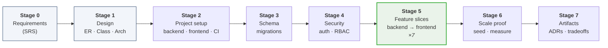
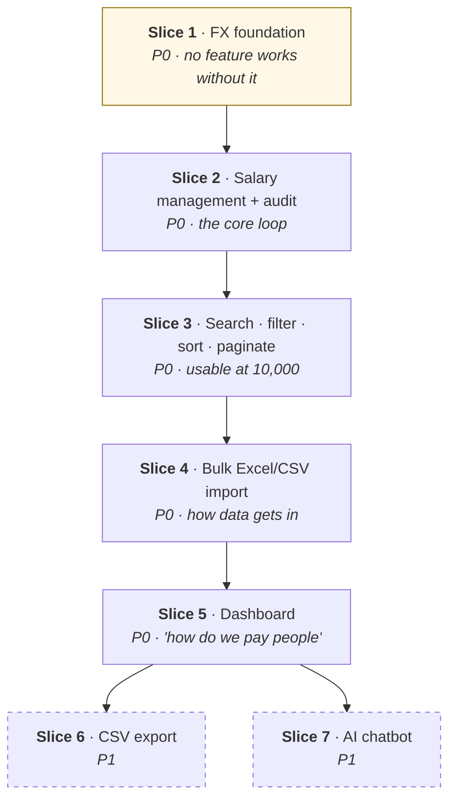

# Step-by-Step Implementation Plan

The single execution-order document. Reads top to bottom: what we do first, what we do
next, and when each feature becomes usable.

| Document | Role |
|---|---|
| **This file** | **The order of work.** Lifecycle stages, feature slices, backend→frontend per feature |
| [`requirements.md`](requirements.md) | *What* to build — the SRS content |
| [`design-notes.md`](design-notes.md) | *Data* shape (ER) and *code* shape (class diagram) |
| [`architecture.md`](architecture.md) | *System* shape — context, container, runtime, deployment |
| [`plans/2026-11-05-salary-management.md`](plans/2026-11-05-salary-management.md) | Per-task TDD steps, exact signatures, exact test names |

---

## The shape of the whole thing

Stages 0–4 are **horizontal** — they are foundations every feature sits on, and building
them per-feature would mean building them seven times. Stage 5 is **vertical** — each slice
goes backend→frontend until an HR Manager can actually do something.

**Why vertical slices after the foundation.** A horizontal plan (all backend, then all
frontend) is finished only at the very end; if the week runs out at 80%, you have an API
nobody can use. A vertical plan is always shippable: running out of time means shipping
five complete features instead of eight half ones. It also forces frontend/backend
integration to happen on day 2 rather than day 5, which is when contract mismatches are
cheap to fix.

---

## Stage 0 — Requirements / SRS ✅ *done*

**Output:** [`requirements.md`](requirements.md) + `Employee Salary Management.docx`
**Commits:** `docs: add requirements document (one-pager) and markdown mirror`

The brief asked for a **one-page** requirements document, so we wrote that rather than a
full IEEE-830 SRS. But the SRS content that actually drives code is captured — just
distributed to where it is useful:

| SRS section | Where it lives |
|---|---|
| Purpose, scope, persona | `requirements.md` → Goal, Scope |
| Functional requirements | `requirements.md` → Features table (P0/P1) |
| Non-functional: performance | This file, Stage 6 + `performance.md` (measured, not asserted) |
| Non-functional: security | `architecture.md` → trust boundaries, data classification |
| Constraints / business rules | `plans/…md` → Global Constraints (USD reporting, frozen FX, NUMERIC money, one open salary row) |
| Exclusions + reasoning | `requirements.md` → Out of Scope |
| Acceptance criteria | Per-slice **Exit** lines in this file; test names in the task plan |

> A 40-page SRS for a one-week build is ceremony. The judgment being shown is picking the
> document weight that matches the decision weight.

## Stage 1 — Design and modelling ✅ *mostly done*

**Output:** [`design-notes.md`](design-notes.md), [`architecture.md`](architecture.md)
**Commits:** `docs: add design notes…`, `docs: add architecture at four zoom levels`

Order within the stage, and why:

1. **Domain vocabulary** — name the concepts before drawing them. This is where
   *salary-as-history* and *salary-history ≠ audit-log* were settled.
2. **ER diagram** — entities, columns, types, and the constraints a diagram cannot draw
   (`ux_salary_open`, check constraints, read-path indexes).
3. **Class diagram** — three layers; `services/` is the only writer.
4. **Architecture** — context → container → runtime → deployment.
5. **ADRs** — five decisions, each with what was rejected. *(Remaining — Stage 7.)*

**The model comes before code because schema is the only layer whose change cost grows with
time.** A service refactor on day 5 is minutes; a schema change on day 5 is a migration
plus a backfill plus every query plus every API type plus every UI type.

## Stage 2 — Project setup *(plan Task 1)*

Both halves of the repo run before either does anything. Scaffolding is foundation;
logging in is a feature and belongs in Stage 4.

**2a — Backend**

| Step | Output |
|---|---|
| 1 | `docker-compose.yml` → Postgres 16 up locally |
| 2 | `pyproject.toml`, `app/config.py` (Pydantic Settings from env), `app/db.py` (engine, `get_db`) |
| 3 | `app/main.py` + `GET /health` |
| 4 | `pytest` harness: `client` fixture, `db_session` fixture rolled back per test |

**Exit:** `pytest` green with one real test (`/health` → 200).
**Commit:** `feat(backend): scaffold FastAPI app with health check and test harness`

**2b — Frontend**

| Step | Output |
|---|---|
| 1 | Vite + React 18 + TypeScript scaffold |
| 2 | `src/api/client.ts` — typed fetch wrapper, normalized `ApiError {status, message, fieldErrors}`. No auth header yet; that arrives in Stage 4 |
| 3 | Router shell with an empty layout, and a page that calls `GET /health` end to end |
| 4 | Vitest + Testing Library; one test asserting the health call renders |
| 5 | Vite dev proxy to the API, so there is no CORS surprise on day 3 |

**Exit:** `npm test` green, and the browser shows a value fetched from the backend. The
full round trip — browser → API → Postgres — works before any feature exists.
**Commit:** `feat(frontend): scaffold React app with typed API client`

**2c — CI**

| Step | Output |
|---|---|
| 1 | GitHub Actions: `pytest` + `ruff` on push |
| 2 | Same workflow: `npm test` + `tsc --noEmit` |

**Exit:** one green pipeline covering both halves.
**Commit:** `ci: run backend and frontend suites on push`

> CI goes in now, not at the end. A pipeline added on day 5 proves nothing; a pipeline from
> commit 1 is why every later commit is known-green.
>
> The frontend is scaffolded on day 1 rather than at Slice 2 for the same reason the slices
> are vertical: the first time the browser talks to the API is the first time you find a
> CORS, proxy or serialization problem, and that is cheap on day 1 and expensive on day 3.

## Stage 3 — Schema *(plan Task 2)*

The ER diagram becomes real tables. **Constraint tests are written first** — they are how
we prove the diagram was implemented rather than just drawn.

| Step | Output |
|---|---|
| 1 | Failing tests: second open salary row rejected; duplicate `(currency, as_of)` rejected; duplicate `employee_code` rejected |
| 2 | ORM models — `employee`, `salary`, `fx_rate`, `user`, `audit_log`, `import_job` |
| 3 | `ux_salary_open` partial unique index + check constraints + read-path indexes |
| 4 | `alembic revision --autogenerate`, review the generated SQL by hand |
| 5 | `alembic upgrade head`, tests pass |

**Exit:** the database — not the application — rejects a second open salary row.
**Commit:** `feat(backend): add effective-dated salary schema with partial unique index`

## Stage 4 — Security foundation *(plan Tasks 3–4)*

Before any data endpoint exists. **Authentication is delegated to Keycloak over OIDC** —
this application validates tokens, it does not issue them, and it never handles a
password. There is no login endpoint and no local credential store.

| Step | Output |
|---|---|
| 1 | Keycloak in `docker-compose`, realm imported from a committed JSON export so a fresh clone gets the same clients, roles and test users |
| 2 | `security.py::verify_token` — fetch JWKS once and cache it, verify signature, `iss`, `aud`, `exp`. Never call Keycloak per request |
| 3 | `get_current_user` — find the local `user` row by the token's `sub`, or create it on first sight. The row exists so `audit_log.actor_id` has a stable target, not to hold credentials |
| 4 | `Role` enum + `require_role(*roles)`, reading `realm_access.roles` **from the token**, never from the database |
| 5 | Frontend: OIDC authorization code + PKCE. Token in memory, refresh through Keycloak, 401 → re-authenticate. No login form of our own |

**Testing without Keycloak.** The suite signs its own tokens with a fixture RSA key and
points the verifier at a fixture JWKS. Tests stay fast and hermetic, CI needs no Keycloak
container, and the code under test is the real verifier — only the key source is swapped.

**Exit:** log in through Keycloak, land on an authenticated shell, and get 401 on a token
that is expired, signed by an unknown key, or carries the wrong issuer or audience.
**Commits:** `feat(backend): validate Keycloak OIDC tokens`, `feat(backend): add
role-based access control from token claims`, `feat(frontend): add OIDC login with PKCE`

> Authorization is retrofitted badly or not at all. Putting `require_role` in place before
> the first data route means every route is written against it from birth.
>
> Delegating authentication is the same judgment applied one level up: password storage,
> reset flows, lockout, rate limiting and MFA are all security-critical and none of them
> are this product's problem. The safest credential handling is the kind you do not write.

---

## Stage 5 — Feature slices

Each slice: **backend model → service → API → tests**, then **frontend page → components →
tests**, then a demo. Slice order is driven by the dependency arrows in the class diagram,
not by the order features appear in the requirements table.

### Slice 1 — FX foundation *(plan Task 5)*

First, because `set_salary` cannot be written without it. Every other slice depends on this
one transitively.

**Backend**
1. Failing tests: exact-date rate; most-recent-rate-before-date; **missing rate raises**;
   future-only rates raise; USD→USD is rate 1.0; rounding is `ROUND_HALF_UP` to 2dp.
2. `services/fx.py` — `get_rate(db, currency, as_of)`, `to_usd(amount, rate)`.
3. `api/fx.py` — `GET /fx-rates`, `POST /fx-rates` (**ADMIN only**).
4. Test: HR_MANAGER posting a rate → 403.

**Frontend** — admin-only FX rate table page. Small and ugly on purpose; the Admin is not
the persona we are designing for.

**Exit:** no code path can produce a salary with a null or guessed USD value.
**Commit:** `feat(backend): add FX rate lookup and USD conversion`

### Slice 2 — Salary management + audit trail *(plan Tasks 6–7, 8 partial, 14)*

The core loop. If only one slice shipped, this is the one.

**Backend**
1. `services/audit.py` — `record(...)`, shares the caller's session, **never commits**.
   Test: the audit row dies with a rolled-back mutation.
2. `services/salary.py` — `set_salary` in one transaction: resolve rate → close open row
   (`effective_to = effective_from - 1 day`) → insert new row with **frozen**
   `usd_amount`/`fx_units_per_usd`/`fx_rate_date` → write audit.
3. Tests, in rising order of importance: first salary opens a row → second closes the first
   → **a later FX rate change does not alter an existing row** → missing rate writes nothing
   → backdated change rejected → audit row carries old and new.
4. `services/employee.py` — `create`, `update`, `set_status`, `search`. The importer calls
   the same functions, so "department and band must exist, `employee_code` is unique, every
   change is audited" is written once. `set_status(INACTIVE)` calls
   `SalaryService.close_for_termination`, so `employee.status`, `employee.termination_date`
   and `salary.effective_to` all move in one transaction.
5. `api/employees.py` — `POST /employees` (**create**), `GET /employees/{id}` (employee +
   current salary + history), `PUT /employees/{id}` (edit details),
   `PUT /employees/{id}/salary`. Handlers delegate; they hold no rules.

**Frontend**
6. `EmployeeDetailPage` — current salary, history newest-first, audit trail.
7. `AddEmployeeForm` — the single-hire path. Import is for batches; nobody builds a
   spreadsheet to onboard one person.
8. `SalaryEditForm` — amount, currency, effective date.
7. Money is rendered **twice, always**: `₹12,00,000 INR · $14,380 USD @ 83.45`. The rate is
   shown because an unexplained converted number is the first thing an HR Manager distrusts.
9. Test: a missing-FX-rate 422 surfaces as a readable sentence, not "Request failed".

**Exit:** add an employee and change someone's pay in the browser; see the old row closed, the
new row open, the USD frozen, and the audit entry written.
**Commits:** `feat(backend): add transactional audit trail writer`, `feat(backend): add
effective-dated salary writes with frozen FX`, `feat(frontend): add employee detail with
salary history and edit`

### Slice 3 — Search, filter, sort, pagination *(plan Tasks 8, 13)*

What makes 10,000 employees navigable. The scale requirement lands here more than anywhere
in the database.

**Backend**
1. `GET /employees?q=&country=&department=&band=&sort=&order=&page=&size=` → `{items, total, page, size}`.
2. Query joins `salary ON effective_to IS NULL` so it rides `ux_salary_open`.
3. Sort fields come from an **allow-list dict** (API name → column). Anything else is 422 —
   this is the SQL-injection boundary.
4. Tests: total count correct; size capped at 200; `q` matches name or code
   case-insensitively; country AND department AND band compose; sort by `usd_amount` desc;
   bad sort field → 422 not 500; an employee with no band is not excluded by an unrelated
   filter.

**Frontend**
5. `EmployeeListPage` + `EmployeeTable` — TanStack Query + TanStack Table in **manual**
   pagination/sorting mode. The table never sorts client-side over a partial page.
6. Search debounced 300 ms; changing a filter resets to page 1; explicit empty state.

**Exit:** 10,000 seeded employees, and the list is instant.
**Commits:** `feat(backend): add employee search, filter, sort, pagination and salary edit`,
`feat(frontend): add employee list with server-side search, filter, sort, pagination`

### Slice 4 — Bulk Excel/CSV import *(plan Tasks 9, 16)*

How the data gets in, and the feature that decides whether they abandon Excel.

**Backend**
1. `parse(file, filename)` — xlsx via `openpyxl`, csv via stdlib, both to the same `RawRow`.
2. `validate(rows)` — currency and country in the reference tables? department known? FX
   rate present? amount > 0? Returns `(valid_rows, row_errors)` where
   `RowError = {row_number, field, message}`.
2b. **One file, every column required** *(F11)*. Each row carries the full employee record
   and the full salary record; the importer upserts both. Unknown `employee_code` creates
   the person; a known code updates only the fields that differ, one audit row each. A
   missing column fails the file before any row; a missing value is a row error. A code
   **absent** from the file changes nothing — absence is never termination.
2c. **No-op detection**, which is what makes export → edit → re-import safe: a row whose
   `amount` and `currency` match the current open salary row writes **no new salary row**
   and no audit row, counted as `salaries_unchanged`. Without this, re-uploading an export
   would close 10,000 open rows and open 10,000 identical ones. A changed `amount` whose
   `effective_from` is not later than the current row's is a row error.
3. `run_import` — **two passes**: validate everything in memory, then commit in one
   transaction only if `errors` is empty. Each row goes through `set_salary`, so import
   cannot skip FX freezing or audit.
4. Tests: xlsx and csv parse identically; missing column fails before any row; missing
   required value is a row error with its row number; bad currency reported with row number;
   **one bad row commits nothing**; a valid 10,000-row file commits all; >20,000 rows → 413;
   unknown code **creates**; changed employee fields update with audit rows;
   **re-importing an unchanged export writes nothing**; a changed amount without a later
   `effective_from` is a row error; employees absent from the file are **not** deactivated.

**Frontend**
5. `ImportPage` — one upload, plus a template download carrying the exact column list.
6. `ImportErrorReport` — a table of row number / field / message, stating plainly that
   **nothing was imported**.
7. Success summary reports created, updated and unchanged **separately** — "10,000 rows
   succeeded" does not tell an HR Manager what happened to their data, and an unexpected
   "847 employees updated" during a pay review needs to be visible immediately.

**Exit:** an empty system is populated from one Excel file — employees and salaries both —
and a deliberately broken file produces a report precise enough to fix in Excel and
re-upload.
**Commits:** `feat(backend): add atomic Excel/CSV import with per-row error reporting`,
`feat(frontend): add bulk import with per-row error report`

> Why all-or-nothing: a half-applied import is the worst available outcome — they cannot
> tell which rows landed, cannot safely re-upload, and the dashboard is wrong invisibly.

### Slice 5 — Dashboard *(plan Tasks 10, 15)*

The literal words of the brief: *answer questions about how the org pays people.*

**Backend**
1. `services/analytics.py::summary(db, country=None, department=None, band=None)` → total
   payroll USD, average, median, highest, lowest, headcount, by-country, by-department,
   **by-band (in rank order)**, currency mix.
2. One SQL statement per group-by over `employee JOIN salary ON effective_to IS NULL`.
   Aggregation runs in Postgres; no row set enters Python.
3. Tests: totals use `usd_amount` not `amount`; only current rows counted; employees without
   salary counted in headcount but excluded from average; empty filter → zeros not nulls;
   filters apply to every aggregate consistently.

**Frontend**
4. `DashboardPage` + `StatCard` + Recharts: payroll by country, headcount by department.
5. Every figure labelled **USD**. Country/department filters drive all stats at once.

**Exit:** the HR Manager answers "what do we spend on payroll in Germany" without touching
a spreadsheet.
**Commits:** `feat(backend): add dashboard aggregates computed in SQL`, `feat(frontend): add
salary analytics dashboard`

### Slice 6 — CSV export *(plan Task 11, P1)*

**Backend** — `GET /employees/export` reusing the Slice 3 filter builder; `StreamingResponse`
over a server-side cursor so 10,000 rows never materialize. Formula-injection prefixes
(`=`, `+`, `-`, `@`) quoted. **The export column list is the import column list**, so an
export can be edited in Excel and uploaded back — that round trip is the annual salary
review workflow, and `test_exported_csv_reimports_without_error` guards it.
**Frontend** — an Export button on the list page that carries the active filters.

**Exit:** export respects filters, ignores pagination, includes local amount, currency and
USD.
**Commit:** `feat(backend): add filtered CSV export`

### Slice 7 — AI chatbot *(plan Task 17, P1)*

Last, deliberately. It is the only feature that is useless without the others and valuable
only once the data is trustworthy — and it adds **no new data-access path**, so building it
last costs no redesign.

**A separate service**, not a module in the core app — see `architecture.md`. It has no DB
driver and no credentials; its tools are HTTP calls to the core API carrying **the caller's
own JWT**, so it can only reach what that user could already reach through the UI.

**Backend**
1. Six whitelisted tools, and nothing else: `get_dashboard_summary`, `count_employees`,
   `top_paid`, `salary_distribution`, `list_countries`, `list_departments`. Each is a call
   to an existing core endpoint, not a query.
2. `answer(question, token)` — tool-calling loop, max 5 turns. **No SQL generation, no
   schema in the prompt, no database session in the process.**
3. System prompt: answer only from tool results, always state the filter behind a figure,
   refuse rather than estimate.
4. Tests (model mocked — we test the loop, not the LLM): the right tool is chosen; tool
   results are echoed as cited figures; an undeclared tool cannot be invoked; an
   unanswerable question refuses **without numbers**; a PII question refuses.

**Frontend** — `ChatPage`: question box, answer with the figures it cited and the filters
that produced them.

**Exit:** "what's the average salary in India vs Germany" answers with cited numbers;
"what will Priya earn next year" refuses and says why.
**Commit:** `feat: add AI chatbot over whitelisted salary query tools`

---

## Stage 6 — Scale proof *(plan Task 18)*

| Step | Output |
|---|---|
| 1 | Failing perf tests (`@pytest.mark.perf`): list < 300 ms, dashboard < 500 ms at 10,000 employees |
| 2 | `scripts/seed.py` — 10,000 employees, 12 countries, 8 departments, 6 currencies, 1–4 salary rows each (~25,000 rows) |
| 3 | `EXPLAIN ANALYZE` on the list and dashboard queries, **before and after** indexes |
| 4 | `performance.md` — the numbers, not adjectives |

**Exit:** the "10,000 employees" claim is a measurement in the repo, not an assertion in a
README.
**Commit:** `perf: add 10k-employee seed and measured query baselines`

> Performance work is scheduled after correctness and **with a measurement**. Any index or
> cache added earlier would be a guess.

## Stage 7 — Artifacts *(plan Task 19)*

| Output | Content |
|---|---|
| `adr/0001` | Effective-dated salary history — rejected: a column on `employee` |
| `adr/0002` | Freeze FX rate at write time — rejected: a computed view |
| `adr/0003` | Chatbot uses whitelisted tools — rejected: text-to-SQL |
| `adr/0004` | Synchronous import — rejected: Celery/queue, with the number that reverses it |
| `adr/0005` | Two roles, no approval workflow — rejected: a workflow engine |
| `tradeoffs.md` | What was not built, and the trigger that reverses each |
| `ai-usage.md` | Where AI was used, the prompts that mattered, **and what AI output was rejected and why** |
| `README.md` | Run instructions, final |

**Commit:** `docs: add architecture, ADRs, trade-offs and AI usage log`

---

## Rolling schedule

Week 1 is P0 only. P1 is stretch, and labelled as stretch rather than promised.

| Day | Work | Demoable at end of day |
|---|---|---|
| **1** | Stages 2–4 | Log in; database holds the real schema; both suites green in CI |
| **2** | Slices 1–2 | Change someone's pay; history and audit prove it |
| **3** | Slices 3–4 | 10,000 employees searchable; a broken file reports its rows |
| **4** | Slice 5 + Stage 6 | Dashboard answers the brief's question, with measured latency |
| **5** | Stage 7 + buffer | Artifacts complete, submission ready |
| *6–7* | *Slices 6–7 (P1)* | *Export and chatbot, if the week allowed* |

**If the week runs short, the cut order is: Slice 7 → Slice 6 → the admin FX UI.** None of
those cuts leaves a half-built feature, because the slices are vertical.

## Definition of done, every step

1. The failing test was written and **seen to fail for the right reason**.
2. The implementation is the minimum that passes it.
3. The whole suite is green, not just the new test.
4. Test and code are in the **same commit**.
5. The message says *why* — the diff already says *what*.
