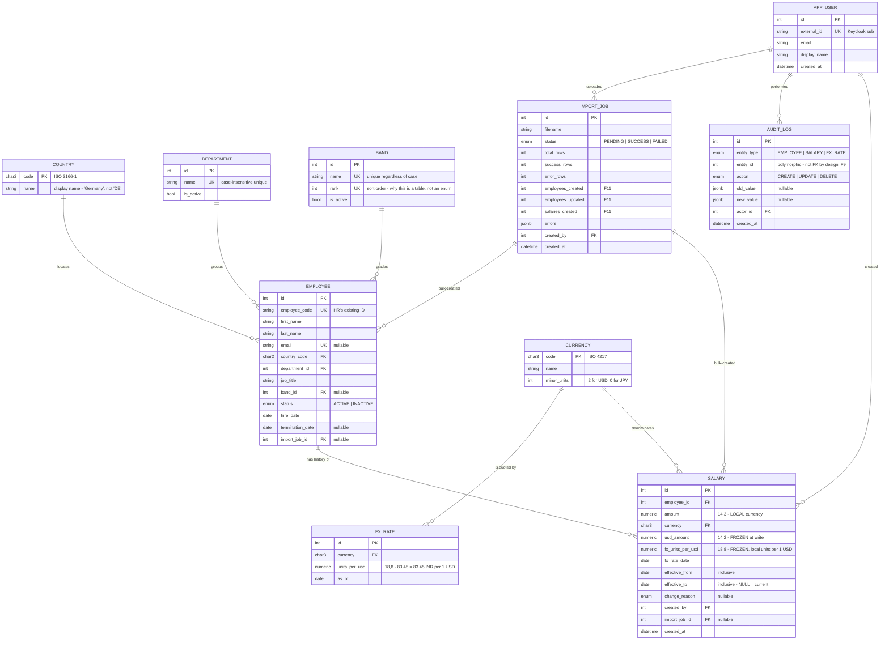

# Data Model Review

A review of the entity model in [`design-notes.md`](design-notes.md) against
[`requirements.md`](requirements.md), done before the first migration is written — the
last point at which a model change is free.

**Method:** take each requirement line, ask what it needs from the model, and ask what
input would make the model give a wrong answer without raising an error. Silent wrongness
is the thing worth hunting; a crash gets fixed on day one.

**Result:** 13 findings. 2 would have produced wrong dashboard numbers with nothing
failing. 4 accepted as deliberate, recorded so they read as decisions rather than
oversights.

| # | Finding | Severity | Verdict |
|---|---|---|---|
| F1 | `department` stored as free text | **High** | Fixed — lookup table |
| F2 | Payroll totals would include terminated employees | **High** | Fixed — business rule + rule on termination |
| F3 | `currency` unvalidated free text in two tables | Medium | Fixed — reference table |
| F4 | `country` unvalidated, and no display name | Medium | Fixed — reference table |
| F5 | Salary is one amount; real comp is base + variable | Medium | Accepted for MVP, trigger recorded |
| F6 | No reason recorded for a salary change | Low | Fixed — nullable enum |
| F7 | Date-interval convention unstated | Low | Fixed — documented + boundary test |
| F8 | `User` not linked to `Employee` | Info | Accepted — deliberate |
| F9 | `audit_log` is polymorphic, cannot be FK-enforced | Info | Accepted — deliberate |
| F10 | Import traceability covers salary but not employee | Low | Fixed — nullable FK |
| F11 | Requirement never says how an employee is **created** | **High** | Fixed — import upserts; plus a single-employee form |
| F12 | `band` was free text with no feature reading it | Medium | Fixed — lookup table with an explicit rank |
| F13 | Identity modelled locally — password hash, role, enabled flag | **High** | Fixed — delegated to Keycloak; `USER` reduced to an audit anchor |

---

## F1 — `department` as free text *(High)*

**Requirement:** *"Search by employee, country, department"* and *"Salary Dashboard — total
payroll, average salary"*, grouped by department.

**The failure.** Data arrives from Excel, typed by humans, 10,000 rows. `Engineering`,
`engineering`, `Eng`, and `Engineering ` are four different departments to a free-text
column. The dashboard then splits one department's payroll across four rows, the
department filter misses most of its employees, and **nothing errors**. The HR Manager's
first reaction is that the numbers are wrong, which ends the product.

This is exactly the class of problem they are leaving Excel to escape, so reproducing it in
the database would be a poor showing.

**Fix.** A `department` table. `employee.department_id` is a foreign key. The importer maps
name → id, case-insensitively and trimmed, and an unknown department becomes a **row error
with a row number**, not a silently created department. Creating departments is an
explicit admin action.

> Counter-argument considered: a `CHECK` constraint against an enum. Rejected — HR renames
> and reorganizes departments, and an enum change is a migration. A table is the same cost
> to build and cheaper to live with.

## F2 — Payroll totals would include terminated employees *(High)*

**Requirement:** *"Total payroll, average salary, highest/lowest salary."*

**The failure.** `employee.status` exists in the model, but no aggregate rule referenced it,
and nothing closes an employee's open salary row when they leave. A terminated employee
keeps a row with `effective_to IS NULL`, so they stay in "current salary" forever. Total
payroll is then overstated by every leaver, permanently and invisibly.

**Fix.** Two rules, both tested:

1. `set_status(INACTIVE)` **closes the open salary row** with the termination date, in the
   same transaction that sets `status` and `termination_date`. Two tables, one commit.
2. A `current_salary` view — `salary JOIN employee WHERE effective_to IS NULL AND
   status = 'ACTIVE'` — which every aggregate, list and export reads instead of `salary`.

The second is deliberately redundant given the first. It costs nothing, states "who is on
the payroll right now" once rather than at every call site, and covers a future code path
that marks someone inactive without going through `set_status`.

Termination does **not** reuse the private `close_open_row` helper. That helper is one
half of a pay change; calling it raw would end someone's pay with no replacement row and
no audit trail. `close_for_termination` closes the row *and* writes the audit entry, so
the event is recorded as the business event it is.

History queries still read `salary` directly, which is correct: history must include
people who have left.

And the dashboard must label which population each figure counts. "Headcount" and "number
of people in the payroll total" are different numbers once anyone has an unset salary, and
showing them unlabelled next to each other invites exactly the distrust we are trying to
avoid.

## F3 — `currency` unvalidated, in two tables *(Medium)*

`salary.currency` and `fx_rate.currency` were both free `CHAR(3)`.

**The failure.** An import row carrying `usd` does not match a rate stored as `USD`, so the
row fails with "no FX rate for usd" — a confusing message for a currency that plainly
exists. Worse, an admin entering `inr` and `INR` creates two rate series for one currency,
and `get_rate` silently picks from one of them.

**Fix.** A `currency` reference table (ISO 4217 code, name, minor units), seeded with the
currencies in use. Both tables take a foreign key. The importer uppercases and validates
before lookup. The table also gives the admin FX page something to populate a dropdown from
instead of a free-text box.

## F4 — `country` unvalidated, and no display name *(Medium)*

Same class as F3. Additionally the dashboard needs **"Germany"**, not `DE` — a chart axis
of two-letter codes is not a product an HR Manager wants to read, and the chatbot cannot
answer "what do we spend in Germany" if the model only knows `DE`.

**Fix.** A `country` reference table (ISO 3166-1 alpha-2 code, name), seeded. `employee`
takes a foreign key.

## F5 — Salary is a single amount *(Medium — accepted)*

Real compensation is base + bonus + allowances. The model has one `amount`.

**Verdict: keep one amount for the MVP.** The requirement says "salary" throughout, and the
dashboard asks for total / average / highest / lowest — all satisfied by a single figure.
Modelling components now adds a table, a join to every aggregate, and an import format
nobody has specified.

**Recorded, because this one is not free to defer:** adding components later means
`salary` becomes a parent of `salary_component`, and every aggregate changes from reading a
column to summing a child table. That is a schema change, not a feature.

**Trigger that reverses it:** the first time anyone asks "what is our bonus spend" or an
import file arrives with a separate bonus column.

## F6 — No reason recorded for a salary change *(Low)*

The audit log answers *who* and *when*. Nobody records *why*. "Show me everyone who got a
promotion increase this year" is a question HR will ask and the chatbot will be unable to
answer, even though it is one column away.

**Fix.** `salary.change_reason` — nullable enum: `NEW_HIRE`, `PROMOTION`, `MERIT`,
`MARKET_ADJUSTMENT`, `CORRECTION`, `IMPORT`. Nullable because history imported from Excel
genuinely does not know. Cheap now; a backfill nobody can perform later.

## F7 — Date-interval convention was unstated *(Low)*

The model closes a row with `effective_to = new.effective_from - 1 day`, which is a
**closed-closed** interval: a row is valid *from* and *to* those dates inclusive.

**Verdict: keep it, and write it down.** Closed-closed reads the way HR speaks ("valid 1
January to 31 March"). The alternative, half-open `[from, to)`, is less error-prone in
queries but displays badly without translation. The cost of the choice is that every
history query must use `<=` on `effective_to`, and off-by-one is easy.

**Fix.** State the convention in the schema comment, and test the boundary explicitly: a
lookup *on* `effective_to` must return that row, and a lookup on the next day must return
the next row.

## F8 — `User` is not linked to `Employee` *(Info — deliberate)*

An HR Manager who is also on the payroll appears twice, unconnected.

**Correct for this scope.** Self-service is out of scope, so the 10,000 employees are
*data*, not *accounts*; there will be one or two users. Linking them would imply a login
path for employees that does not exist and should not be hinted at in the schema.

Stated here because a reviewer who notices it should see a decision, not a gap.

## F9 — `audit_log` is polymorphic *(Info — deliberate)*

`(entity_type, entity_id)` cannot be a foreign key, so the database cannot guarantee an
audit row points at a real record.

**Accepted.** The alternative — one audit table per entity — triples the schema and the
writing code to buy referential integrity on an append-only log that is never joined in a
report. The mitigation is that only `audit.record()` writes it, and its `entity_type` comes
from an enum, not a string literal at the call site.

## F10 — Import traceability covers salary but not employee *(Low)*

`salary.import_job_id` records which upload created a salary row, but an import can create
employees too, and those had no link.

**Fix.** Nullable `employee.import_job_id`. When an import turns out to be wrong, "which
rows did that file create" needs to be answerable for both tables.

## F11 — Nothing in the requirement creates an employee *(High)*

**Requirement:** the Features table offers *"View and Edit Employee salary record"* and
*"Bulk salary data import"*. Neither creates an employee, and no other line does.

**The failure.** On day one the database is empty and all 10,000 employees live in Excel.
If import carries only salaries, there is nothing for them to attach to — every row fails
with "unknown employee code", and the only way to onboard is to hand-type 10,000 people
through a form. The product cannot be adopted.

Import carrying employees is therefore not a design preference; the migration forces it.

**But import alone is not enough either.** Nobody builds a spreadsheet to onboard one new
hire. Both paths are needed, and they are needed for different reasons:

| Path | Used for | Volume |
|---|---|---|
| **Bulk import** | Initial migration; monthly joiner/leaver batches; annual salary review | 1–10,000 rows |
| **Single-employee form** | One new hire | 1 |

### What import actually does: one file, all columns required

**One upload. One template. Every column mandatory.** Each row carries the full employee
record and the full salary record, and the importer upserts both.

A two-file split (employees separately from salary changes) was considered and rejected.
The problem a split was meant to solve is that "cell left blank" and "column not present"
become indistinguishable in a combined format — but that only bites when columns are
*optional*. **Making every column required removes the ambiguity more cheaply than
splitting the upload does**, and leaves the HR Manager with one thing to learn instead of
two.

| Column group | Columns | Required |
|---|---|---|
| Identity | `employee_code` | yes — the match key |
| Employee | `first_name`, `last_name`, `country_code`, `department`, `job_title`, `hire_date`, `status` | yes |
| Employee (graded) | `band` | may be empty — not every role is banded |
| Employee (optional by nature) | `email`, `termination_date` | may be empty; empty means *not set*, and the column is always present |
| Salary | `amount`, `currency`, `effective_from` | yes |
| Salary (optional by nature) | `change_reason` | may be empty |

A missing **column** fails the whole file before any row is read. A missing **value** in a
required column is a row error with its row number.

### The workflow this unlocks: export → edit → re-import

Requiring every column would be a burden if HR had to assemble the file by hand. They do
not: **CSV export produces exactly the import format.** The annual salary review becomes

> export the filtered set → change the `amount` column in Excel → upload the same file

which is the workflow they already have, minus the parts that made it painful. This is why
one file beats two: a round trip needs a single shared format, and a split would give the
export nothing to round-trip to.

The two features are therefore the same column list, tested together:
`test_exported_csv_reimports_without_error`.

### No-op detection — the rule that makes the round trip safe

Re-importing an exported file would otherwise close 10,000 open salary rows and open
10,000 identical new ones, destroying the history the design exists to protect.

| Row compared to the current open salary row | Behaviour |
|---|---|
| `amount` and `currency` identical | **No salary row written.** Counted as `salaries_unchanged`. No audit row. |
| `amount` or `currency` differ | `set_salary` — closes the open row, opens the new one |
| `amount` differs but `effective_from` is not later than the current row's | **Row error.** A pay change needs a date it takes effect from |

Employee fields follow the same principle: only *changed* fields are written, and each
changed field gets its own audit row. Re-uploading an untouched export is a no-op across
the whole file.

### Rules that hold for every row

| Row condition | Behaviour |
|---|---|
| `employee_code` not found | **Create** the employee, then create their salary row |
| `employee_code` found, employee fields differ | **Update**, with an audit row per changed field |
| `employee_code` found, nothing differs | Nothing written, counted as unchanged |
| `employee_code` absent from the file entirely | **Nothing** |
| Any row invalid | **Nothing commits.** Whole-file rejection with a row-numbered report |

**Absence is not termination.** A file containing 50 rows must never deactivate the other
9,950 employees. Someone will one day upload a single-department extract, and a model that
treats a missing row as a leaver would terminate the entire company. Leavers are marked by
the `status` column or through the UI — never by omission.

**Every pay change still routes through `set_salary`**, so a bulk import cannot skip FX
freezing or the audit trail. That is the point of the service layer owning the writes.

### The cost of this choice, stated plainly

A file that only changes pay must still carry every employee column. If someone edits
those columns carelessly during a pay exercise, stale values are written back over good
data — and the audit trail will record it as a deliberate edit, because the importer cannot
tell the difference.

Two mitigations, both cheap: the success summary reports employee updates and salary
changes as **separate counts**, so an unexpected "847 employees updated" during a pay
review is visible immediately; and every field change is individually audited and
reversible.

**Trigger that would reverse this decision:** if an import routinely reports employee
updates nobody intended, split the upload.

### Consequences for the model

- `employee.import_job_id` — already added in F10, now load-bearing rather than nice to have.
- `import_job` gains counters, because "success_rows: 10,000" does not tell an HR Manager
  what happened: `employees_created`, `employees_updated`, `salaries_created`,
  `salaries_unchanged`. The last one is how a safe round trip proves it was safe.
- Employee updates from import write audit rows exactly like UI edits — a mass update is
  the easiest way to quietly corrupt 10,000 records, so it is the case that most needs the
  trail.

### Consequences for the plan

- Slice 2 gains `POST /employees` and an **Add Employee** form.
- Slice 4 builds one importer over the full column set, with no-op detection.
- Slice 6 (CSV export) shares the importer's column list, making export → edit → re-import
  the salary-review workflow. The template download is P0 even though export itself is P1.
- New tests: `test_import_creates_unknown_employee`,
  `test_import_updates_changed_employee_fields_with_audit_rows`,
  `test_reimporting_an_unchanged_export_writes_nothing`,
  `test_unchanged_salary_row_does_not_create_a_duplicate_history_row`,
  `test_changed_amount_without_later_effective_from_is_a_row_error`,
  `test_import_does_not_deactivate_employees_absent_from_file`,
  `test_missing_required_value_is_a_row_error_with_row_number`,
  `test_exported_csv_reimports_without_error`,
  `test_import_job_reports_created_updated_and_unchanged_separately`.

> The requirement is not wrong, it is **silent** — and silence on an input is not permission
> for that input to break the product. Resolving it here, against the one-page document,
> costs a paragraph; discovering it on migration day costs the adoption.

## F13 — identity was modelled locally *(High)*

**The model carried `password_hash`, `role` and `is_active` on `USER`** — a complete local
identity system. Authentication is now delegated to **Keycloak over OIDC**, so all three
are wrong to keep.

| Column | Why it goes |
|---|---|
| `password_hash` | The application never sees a password. Storing a hash it can never populate is an attack surface with no function |
| `role` | The token carries the roles. A local copy is an authorization fact that drifts the moment someone changes a role in Keycloak and nothing tells the database — and it drifts *open*, which is the dangerous direction |
| `is_active` | Keycloak owns enablement. Two places to disable someone means one place that gets forgotten |

**Why the table does not disappear entirely.** `audit_log.actor_id` needs a stable local
target. "Who changed this salary" must still answer in three years, from the database
alone, without depending on an external service being reachable or on a Keycloak realm
that has since been rebuilt. So the row stays, reduced to identity facts:

| Column | Note |
|---|---|
| `external_id` | The Keycloak `sub` — a UUID that is stable across email and name changes. **Not** the email: people change email, and an audit trail keyed on a mutable field is not an audit trail |
| `email`, `display_name` | Copied from the token for display. Refreshed on each login, and deliberately not authoritative |
| `created_at` | The row is created just-in-time the first time a valid token arrives for an unseen `sub`. There is no `last_seen_at`: tracking it would make every GET a write transaction, all contending for the same row, to serve a column no feature reads |

**The trade-off being accepted.** Validating locally against Keycloak's published keys
means a token stays usable until it expires even if the account is disabled. Introspecting
on every request would close that window, at the cost of a network round trip per request
and Keycloak becoming a hard dependency of every page load. Short access-token lifetimes
(5–10 minutes, with refresh) narrow the window to something smaller than most incident
response takes anyway.

**Tests:** `test_token_signed_by_an_unknown_key_is_rejected`,
`test_token_with_wrong_issuer_is_rejected`,
`test_token_with_wrong_audience_is_rejected`,
`test_expired_token_is_rejected`,
`test_first_valid_token_for_an_unseen_sub_creates_a_user_row`,
`test_second_token_for_the_same_sub_does_not_create_a_duplicate`,
`test_role_comes_from_the_token_not_the_database`.

---

## F12 — `band` was a column nothing read *(Medium)*

**Requirement:** silent. `band` does not appear in it; the column came from the first
draft of the model.

**The failure.** A nullable text column that no feature filters, groups or sorts by is a
field HR dutifully fills in and nobody ever looks at. Within two reorganizations it is
wrong, and because nothing reads it, nobody notices. This document already argues against
exactly that pattern when rejecting a `manager_id` — the same test has to apply here.

So the choice was: give it a purpose or delete it.

**Verdict: give it a purpose.** *"Are we paying Band 5 consistently in India and Germany?"*
is the question multi-country salary data exists to answer, and job title cannot answer it
— the same title means different things in different offices. Band is the normalized axis.
It is also the chatbot's strongest use case.

**Fix.** A `band` table, and `band` becomes a filter and a dashboard group-by alongside
country and department.

| Column | Why |
|---|---|
| `name` | Unique regardless of case — `L3` and `l3` must not split a band across two chart rows, exactly as with department *(F1)* |
| `rank` | **The reason this is a table and not an enum.** Bands are ordered; text is not. `L1, L10, L11, L2, L3` is how text sorts, and an "average pay by band" chart in that order is meaningless |
| `is_active` | A retired band stays readable in historical reports |

`employee.band_id` is **nullable** on purpose: contractors and executives commonly sit
outside a banding system, and forcing a band on them produces junk in a required field,
which is worse than an empty one.

**Deliberately excluded: `min_salary` / `max_salary` on the band.** Tempting, but ranges
are per-country — band 5 in India is not band 5 in Germany — so it needs a
`band_range(band_id, country_code, min, max)` table, and that is compensation planning,
which is out of scope. Add it when someone asks "who is paid outside their range".

**Consequences for the plan:** `band` joins the Slice 3 filter allow-list and the Slice 5
dashboard group-bys. New tests: `test_filter_by_band`,
`test_dashboard_groups_by_band_in_rank_order`,
`test_import_rejects_unknown_band_name`,
`test_employee_without_band_is_valid`.

---

## Revised model

Six entities became nine; the three new ones are small, static reference tables.

> The revised diagram below is now also the ER diagram in
> [`design-notes.md`](design-notes.md), which is where the model lives. It is repeated
> here so this review reads on its own.



### How to read the diagram

Crow's foot notation. Each side of the line carries two characters: the **inner** one is
the minimum, the **outer** one is the maximum. Read each side independently.

| Symbol | Minimum | Maximum | Reads as |
|---|---|---|---|
| `\|\|` | one | one | exactly one |
| `o\|` | zero | one | zero or one (optional) |
| `}\|` | one | many | one or more |
| `}o` | zero | many | zero or more |

So `COUNTRY ||--o{ EMPLOYEE` splits into:

- left side `||` — an employee belongs to **exactly one** country
- right side `o{` — a country has **zero or more** employees

That is a **one-to-many**. Every relationship in this model is one-to-many; there is no
one-to-one and no many-to-many. That is not an accident — a one-to-one usually means two
tables that should be one, and a many-to-many needs a join table that would have to earn
its place.

**Where the "many" end lives tells you where the foreign key goes.** The crow's foot
(`{`) always points at the table holding the foreign key: `employee` holds
`country_code`, `salary` holds `employee_id`.

### Relationships in words

| Relationship | Cardinality | Why |
|---|---|---|
| Employee → Salary | one-to-many | Salary is a **history**, not a field. Exactly one row is open at a time. |
| Country → Employee | one-to-many | Validates import, gives the dashboard a display name |
| Department → Employee | one-to-many | Keeps dashboard grouping from splitting on typos *(F1)* |
| Band → Employee | one-to-many | Pay grade, nullable. A table rather than text because bands are **ranked** *(F12)* |
| Currency → Salary | one-to-many | Validates import; the local currency the amount is stored in |
| Currency → FxRate | one-to-many | One rate series per currency, one rate per day |
| FxRate → Salary | **none** | **Intentionally no foreign key.** The rate is *copied* onto the salary row, not referenced. A reference would let an edited rate change a historical figure — the thing the whole design prevents. |
| User → Salary (`created_by`) | one-to-many | Who entered the figure — a business fact, distinct from the audit row |
| User → AuditLog | one-to-many | Who made a change — a compliance fact |
| ImportJob → Employee | one-to-many | Import **creates** employees, not just salaries — it is the only viable migration path *(F11)* |
| ImportJob → Salary | one-to-many | "Which rows did that file create" *(F10)* |

**The relationship worth arguing about is the one that isn't there.** `salary.fx_units_per_usd`
duplicates a value that exists in `fx_rate`, and a reviewer may read it as denormalization
to be cleaned up. It is deliberate: normalizing it would make October's payroll total
change when an admin corrects October's rate in November, after that total was exported and
sent to Finance. Copying the rate is what makes history immutable.

### Additional constraints from this review

```sql
-- F1: department names are unique regardless of case
CREATE UNIQUE INDEX ux_department_name ON department (lower(name));

-- F2: an inactive employee cannot have an open salary row
ALTER TABLE employee ADD CONSTRAINT ck_inactive_has_termination_date
    CHECK (status = 'ACTIVE' OR termination_date IS NOT NULL);

-- F2: payroll aggregates filter on this; make it cheap
CREATE INDEX ix_employee_status ON employee (status) WHERE status = 'ACTIVE';

-- F3/F4: reference integrity replaces free text
--   employee.country_code  -> country.code
--   employee.department_id -> department.id
--   salary.currency        -> currency.code
--   fx_rate.currency       -> currency.code
```

### Tests this review adds

Pinned to the tasks that own the code, in the task plan's step style.

| Test | Task |
|---|---|
| `test_import_rejects_unknown_department_with_row_number` | Import |
| `test_department_lookup_is_case_and_whitespace_insensitive` | Import |
| `test_payroll_total_excludes_inactive_employees` | Dashboard |
| `test_terminating_employee_closes_open_salary_row` | Salary service |
| `test_headcount_and_salaried_count_reported_separately` | Dashboard |
| `test_import_rejects_lowercase_currency_not_in_reference_table` | Import |
| `test_dashboard_groups_by_country_display_name` | Dashboard |
| `test_lookup_on_effective_to_date_returns_that_row` | Salary service |
| `test_lookup_on_day_after_effective_to_returns_next_row` | Salary service |

---

## What the review did not change

Stated so the next reviewer does not re-litigate settled ground:

- **Salary stays a history table**, not a column on `employee`. Without it, "what did we pay
  in Q2" has no answer.
- **`usd_amount` and `fx_units_per_usd` stay copied onto the row**, not computed. See above.
- **`salary_history` and `audit_log` stay separate tables.** One is a business fact that
  feeds every report; the other is a compliance fact that must never enter one.
- **No org hierarchy, no manager link.** Approval workflows are out of scope, and a
  `manager_id` with no feature behind it is a column that will be wrong in six months
  because nothing reads it.
